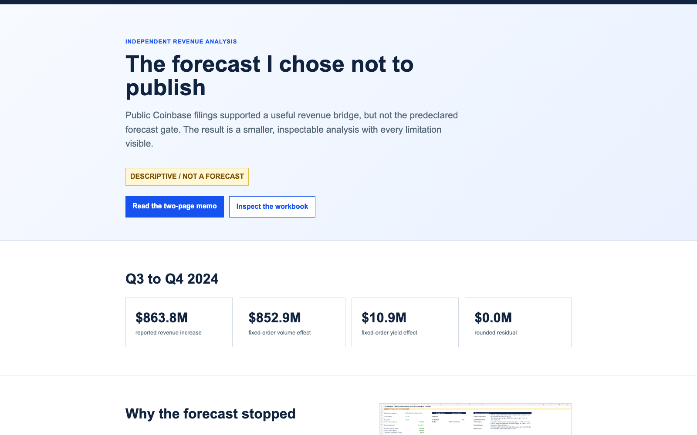

# COIN revenue bridge: Q3 to Q4 2024

[](https://github.com/RahilBhavan/coin-revenue-bridge/actions/workflows/ci.yml)
[](LICENSE)

**Live:** https://revenue.rahilbhavan.com/

[](https://revenue.rahilbhavan.com/)

A source-backed bridge that splits Coinbase's Q3 to Q4 2024 consumer transaction revenue change into volume and effective-yield effects. It uses only public SEC filings, frozen and hashed in this repository. It produces a decision memo, a seven-sheet workbook, a reviewer packet and a static case study site.

## Results

Consumer transaction revenue rose **$863.8M**, from $483.3M in Q3 2024 to $1,347.1M in Q4 2024, while consumer spot volume rose from $34B to $94B. Volume drove almost all of it. The split depends on factor order, so the analysis shows all three valid views:

| Bridge method | Volume effect | Effective-yield effect | Total |
|---|---:|---:|---:|
| Volume first | $852.9M | $10.9M | $863.8M |
| Yield first | $859.9M | $3.9M | $863.8M |
| Symmetric Shapley | $856.4M | $7.4M | $863.8M |

Source: `outputs/final-package/bridge-attribution.csv`. Each view reconciles to the reported change with a $0.0M rounded residual. Effective yield is consumer revenue divided by consumer spot volume. It is a proxy, not Coinbase's fee rate.

Planning sensitivities around the Q4 2024 actuals, from `outputs/final-package/planning-scenarios.csv`:

| Case | Volume change | Yield change | Implied revenue |
|---|---:|---:|---:|
| Downside | -20% | -10 bps | $1,002.5M |
| Reference (Q4 2024 actual) | 0% | 0 bps | $1,347.1M |
| Upside | +20% | +10 bps | $1,729.3M |

These are mechanical sensitivities, not guidance, probabilities, or forecasts.

Latest quarter (added 2026-10-25), from `outputs/final-package/latest-bridge.csv`. Consumer transaction revenue fell from $566.9M in Q1 2026 to $451.7M in Q2 2026 while consumer crypto spot volume fell from $33.8B to $25.8B:

| Bridge method | Volume effect | Effective-yield effect | Total |
|---|---:|---:|---:|
| Volume first | -$134.2M | +$18.9M | -$115.2M |
| Yield first | -$140.1M | +$24.8M | -$115.2M |
| Symmetric Shapley | -$137.1M | +$21.9M | -$115.2M |

This bridge uses Coinbase's newest volume definition (Q2 2026 deck: excludes stablecoin trading volume, routed trades count at half). Its yield is not comparable with the 2024 bridge. The memo, reviewer packet and workbook still cover only the Q3 to Q4 2024 bridge.

**Why there is no forecast.** The design set a gate before looking at results: at least twelve comparable quarters (eight to train, four to test). `python3 scripts/forecast_gate.py` reports the count from the data: **9 of 12**. The nine quarters are Q3 2023 to Q3 2025. Twelve calendar quarters now have data through Q2 2026, but Coinbase redefined trading volume in Q4 2025 and again in Q2 2026, and its Q2 2026 10-Q says Trading Volume is no longer a key metric. Only five quarters (Q2 2025 to Q2 2026) exist under the newest definition, so the quarters cannot be added together. The project reports the bridges and publishes no forecast. The [validation report](outputs/final-package/validation-report.md) lists the forecast checks as `NOT RUN`.

The deliverables:

- [Live case study](https://revenue.rahilbhavan.com/), also in [`dist/`](dist/index.html)
- [Two-page decision memo (PDF)](outputs/final-package/decision-memo.pdf)
- [Seven-sheet workbook (XLSX)](outputs/final-package/revenue-analysis.xlsx), formula-driven
- [Reviewer packet (PDF)](outputs/final-package/reviewer-packet.pdf), the strongest objections and how to test them
- [Executive package (ZIP)](outputs/coin-revenue-bridge-executive-package.zip): memo, workbook, reviewer packet, review protocol
- [Validation report](outputs/final-package/validation-report.md) and [machine-readable evidence](outputs/final-package/validation-evidence.json)

## How it works

- `data/raw/` holds the frozen source documents. `artifacts/source-register.csv` records a SHA-256 hash for each of the 17 registered documents.
- `data/processed/` holds reviewed metric observations, one row per metric, quarter, and publication vintage. Original and recast values stay as separate rows.
- `src/strategic_finance/` and `sql/` are a Python and SQLite core. It enforces information cutoffs and definition families, and it computes the bridges with decimal arithmetic.
- `scripts/` builds the workbook, PDFs, and site, and holds the evidence validator.
- `outputs/final-package/` is the reviewer package. Its standalone `reproduce.py` recomputes the bridge from package-local files.

## Run it

Python 3.9 or later, standard library only. CI runs Python 3.11. The tests and `reproduce.py` also passed locally on 3.9 and 3.14 (2026-10-24).

```sh
python3 -m unittest discover -s tests
python3 outputs/final-package/reproduce.py
python3 scripts/forecast_gate.py
python3 scripts/build_latest_bridge.py
python3 scripts/prepare_descriptive_reporting.py --input data/processed/analytics-ready-metric-observations.csv --output-dir work/real-reporting-inputs --from-period 2024-09-30 --to-period 2024-12-31
python3 scripts/build_enhanced_analysis.py
python3 scripts/validate_final_evidence.py
```

The test suite runs 26 tests. `reproduce.py` prints `PASS: bridge reconciles within $0.1M`. After the two prep steps, `validate_final_evidence.py` reports 17 checks as `PASS`. It exits 1 if any check fails. Without the prep steps it skips the checks that need their outputs and prints the command to run.

The workbook is built with a separate spreadsheet tool that is not part of this repo. The committed workbook is the source of truth.

## Repository layout

- `01-brief/` to `06-execution/`: planning documents, from the brief to the first build
- `artifacts/`: source register and artifact manifest
- `data/`: raw SEC documents and processed metric observations
- `dist/`: the static site that Vercel serves
- `docs/`: README screenshot, social card, and the "no forecast" post images with alt text
- `outputs/revenue-bridge-card/`: the revenue bridge post card (1080x1080), phone-feed frames, alt text and palette check
- `outputs/`: final reviewer package, executive package, descriptive bridge, and public case study
- `reporting/`: reporting pipeline, fixtures, and sample outputs
- `scripts/`: builders, reproduction scripts, and the evidence validator
- `sql/`: SQLite schema and bridge queries
- `src/strategic_finance/`: the analytical core
- `templates/`: memo and reviewer packet templates
- `tests/`: unit tests and their fixture

## Documentation

`docs/` holds only images and the social card source. The project documents live in the numbered folders:

- [Project brief](01-brief/project-brief.md): the decision, the audience, and the scope. [Open decisions](01-brief/open-decisions.md): unresolved gaps and fallbacks.
- [Data feasibility](02-research/data-feasibility.md), [feasibility verdict](02-research/feasibility-verdict.md), and [source register](02-research/source-register.md): which filings support the analysis and why the forecast gate failed.
- [Design options](03-design/design-options.md) and [architecture](03-design/architecture.md): the three designs compared and the data model.
- [Deliverables](04-deliverables/deliverables.md), [validation plan](05-validation/validation-plan.md), and [adversarial review](05-validation/adversarial-review.md): acceptance criteria and the strongest objections.
- [First build](06-execution/first-build.md): the build milestones.
- [Artifact manifest](artifacts/manifest.md), [decision log](decisions.tsv), [release readiness](RELEASE-READINESS.md), and [AI contribution record](outputs/final-package/ai-contribution.md): what was built, decided, checked, and assisted.

## Sources

`data/raw/` holds 17 public documents: ten Coinbase shareholder letters (Q3 2023 to Q4 2025) filed as SEC 8-K exhibits, the Q1 and Q2 2026 earnings decks (8-K exhibits), the 2025 Form 10-K, the Q1 and Q2 2026 Forms 10-Q, and two SEC submissions indexes for Coinbase Global, Inc. (2026-09-20 and 2026-10-25). It also keeps the EDGAR filing index page for nine of the letters and the four 2026 filings. All come from SEC EDGAR, and `artifacts/source-register.csv` lists the URL, accession number, and hash for each registered document. They are Coinbase's documents, reproduced here for verification. The MIT license covers this project's code and analysis, not these third-party filings.

## Scope and limits

- Independent analysis of public filings. Not affiliated with or endorsed by Coinbase, and uses no internal Coinbase data.
- Descriptive only: the bridge explains a reported change. It makes no causal claim, forecast, or investment recommendation.
- Consumer spot volume excludes derivatives, and some consumer revenue does not tie to spot volume, so effective yield is a proxy.
- No external practitioner has reviewed the work yet. The [review protocol](outputs/public-case-study/practitioner-review.md) states this.

## License

MIT. See [LICENSE](LICENSE).

Part of [Rahil Bhavan's projects](https://github.com/RahilBhavan).
